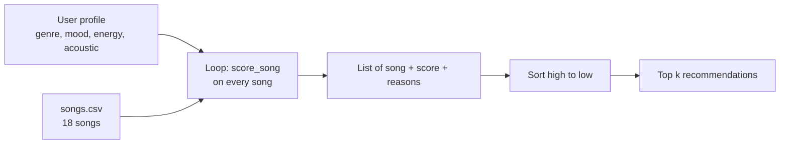

# 🎵 Music Recommender Simulation

## Project Summary

In this project you will build and explain a small music recommender system.

Your goal is to:

- Represent songs and a user "taste profile" as data
- Design a scoring rule that turns that data into recommendations
- Evaluate what your system gets right and wrong
- Reflect on how this mirrors real world AI recommenders

**My version, VibeCheck 1.0,** reads an 18-song catalog from a CSV, scores every song against a listener's favorite genre, favorite mood, target energy, and acoustic preference, and prints the top 5 with a reason for every point awarded. I tested it with six profiles, including three edge cases, ran a weight experiment, and documented its biases in the [Model Card](model_card.md).

---

## How The System Works

### How real recommenders work

Apps like Spotify and TikTok mix two approaches. **Collaborative filtering** looks at other people's behavior ("listeners like you also played this"), using signals like likes, skips, replays, and playlist adds. **Content-based filtering** looks at the songs themselves (genre, tempo, energy, mood) and suggests tracks that sound like what you already enjoy. Real platforms combine both, plus context like time of day, and then run a ranking model over millions of songs.

My simulation is **content-based only**. There are no other users, so it compares one listener's taste profile against each song's attributes. It prioritizes **genre first, then mood, then how close the song's energy is to what the listener wants**, and uses acousticness to separate calm acoustic tracks from produced ones.

### Features used

**`Song`**
- `genre` (e.g. pop, lofi, rock)
- `mood` (e.g. happy, chill, intense)
- `energy` (0.0 to 1.0)
- `acousticness` (0.0 to 1.0)
- Also stored but not scored yet: `title`, `artist`, `tempo_bpm`, `valence`, `danceability`

**`UserProfile`**
- `favorite_genre`
- `favorite_mood`
- `target_energy` (0.0 to 1.0)
- `likes_acoustic` (True / False)

### Dataset

The starter catalog had 10 songs. I added 8 more (ids 11–18) to cover genres and moods that were missing: hip hop, classical, metal, country, edm, r&b, reggae, and folk, with moods like confident, melancholy, angry, nostalgic, euphoric, romantic, uplifting, and sad. The catalog now has **18 songs** across 15 genres.

### Default taste profile

```python
user_prefs = {
    "favorite_genre": "pop",
    "favorite_mood": "happy",
    "target_energy": 0.8,
    "likes_acoustic": False,
}
```

**Critique of this profile:**
- It *can* tell "intense rock" from "chill lofi": energy alone separates them (Storm Runner at 0.91 vs. Library Rain at 0.35), and the acoustic preference pushes the same way.
- It is narrow in one important way: genre is an **exact text match**, so "indie pop" (Rooftop Lights) gets no genre points even though a pop fan would probably like it.
- Because genre is worth twice as much as mood, **Gym Hero** (pop, *intense*) outranks Rooftop Lights (indie pop, *happy*) for this profile: 3.35 vs. 2.29. A "happy pop" listener gets a workout track as their #2 pick.

### Planned scoring rule (for one song)

| Check | Points |
|---|---|
| Genre matches `favorite_genre` | +2.0 |
| Mood matches `favorite_mood` | +1.0 |
| Energy closeness: `1 - abs(song.energy - target_energy)` | 0.0 to +1.0 |
| Acoustic fit: `acousticness` if `likes_acoustic`, else `1 - acousticness`, times 0.5 | 0.0 to +0.5 |

Energy is scored by **closeness**, not "higher is better," so a listener who wants 0.4 energy is not pushed toward the loudest songs. Tempo is left out because in this dataset it rises and falls with energy, so scoring both would count the same thing twice.

### Ranking rule (for the whole list)

Score every song in the catalog, sort from highest to lowest score, and return the top `k`. The scoring rule judges one song at a time; the ranking rule is what turns those scores into a recommendation list.

### Data flow



### Expected bias

Lofi still has 3 songs and pop has 2, while the other 13 genres have only one each, and genre is worth the most points. A metal or jazz fan gets exactly one genre match and then a list filled in by energy alone, while a lofi fan gets three strong matches. The system may also ignore a great song that matches the listener's mood but not their genre, and exact text matching treats "indie pop" as unrelated to "pop."

---

## Getting Started

### Setup

1. Create a virtual environment (optional but recommended):

   ```bash
   python -m venv .venv
   source .venv/bin/activate      # Mac or Linux
   .venv\Scripts\activate         # Windows

2. Install dependencies

```bash
pip install -r requirements.txt
```

3. Run the app:

```bash
python -m src.main
```

### Running Tests

Run the starter tests with:

```bash
pytest
```

You can add more tests in `tests/test_recommender.py`.

---

## Sample Recommendation Output

Output of `python -m src.main` for the default "Happy Pop" profile:

```
Loaded songs: 18

================================================================
Profile: Happy Pop (default)
  genre=pop, mood=happy, energy=0.8, likes_acoustic=False
================================================================
1. Sunrise City by Neon Echo  [pop, happy]
   Score: 4.39
     - genre match: pop (+2.0)
     - mood match: happy (+1.0)
     - energy 0.82 vs target 0.80 (+0.98)
     - produced sound, acousticness 0.18 (+0.41)

2. Gym Hero by Max Pulse  [pop, intense]
   Score: 3.35
     - genre match: pop (+2.0)
     - energy 0.93 vs target 0.80 (+0.87)
     - produced sound, acousticness 0.05 (+0.47)

3. Rooftop Lights by Indigo Parade  [indie pop, happy]
   Score: 2.29
     - mood match: happy (+1.0)
     - energy 0.76 vs target 0.80 (+0.96)
     - produced sound, acousticness 0.35 (+0.33)

4. Concrete Echoes by Blockwise  [hip hop, confident]
   Score: 1.42
     - energy 0.78 vs target 0.80 (+0.98)
     - produced sound, acousticness 0.12 (+0.44)

5. Storm Runner by Voltline  [rock, intense]
   Score: 1.34
     - energy 0.91 vs target 0.80 (+0.89)
     - produced sound, acousticness 0.10 (+0.45)
```

**Screenshot or video** *(optional)*: <!-- Insert a screenshot or demo video link here -->

---

## Experiments You Tried

- **Six user profiles.** Three main tastes (Happy Pop, Chill Lofi, Deep Intense Rock) and three edge cases (Sad but High Energy, a genre that isn't in the catalog, and an acoustic-loving metal fan). Every profile's obvious best song came out #1, but the edge cases filled spots #2–5 with near-tied loud songs, and the sad listener got happy pop songs at #3 and #4.
- **Weight shift: genre 2.0 to 1.0, energy 1.0 to 2.0.** The #1 song didn't change for any profile. For Happy Pop it was an improvement (Rooftop Lights, an actually happy song, moved above the intense Gym Hero); for the others the lower spots just reshuffled. I kept the original weights.
- **Gym Hero** appeared in the top 5 for 5 of 6 profiles, because it's pop, intense, and very high energy all at once.

Full outputs and profile-by-profile comparisons are in the [Model Card](model_card.md#7-evaluation).

---

## Limitations and Risks

- Tiny, made-up catalog: 18 songs, and 13 of 15 genres have only one song, so fans of those genres get one good match and then filler.
- Genre is worth twice as much as mood, so a genre match can outrank a song that actually fits the listener's mood.
- Genre is an exact text match: "indie pop" earns nothing from a pop fan.
- Ignores lyrics, language, tempo, valence, listening history, and context like working out vs. studying.
- One genre and one mood per user, so mixed tastes can't be represented.

---

## Reflection

Read the full [**Model Card**](model_card.md), including my personal reflection.

Building VibeCheck showed me that a recommender is really two simple steps: a scoring rule that judges one song, and a ranking rule that sorts every song by that score. The "prediction" is just which songs end up closest to the profile on the features I chose to measure, and the weights I picked decide what "closest" means. Small choices, like making genre worth 2 points instead of 1, change what every listener sees.

Bias showed up in two places. The data was uneven, so lofi fans got three strong matches while metal and folk fans got one. And the scoring rules favored songs like Gym Hero that score well on the heaviest-weighted features, even when they don't fit what the listener wants. I really questioned why Gym Hero kept scoring higher than songs that matched the listener's mood, and when I looked deeper, the answer was that one fixed set of weights treats every genre the same. I think the system should change its scoring per genre: for pop, the mood and vibe probably matter more than the label, while for metal or classical the genre itself says a lot. In a real app with millions of users, the same kind of imbalance could keep pushing the same popular artists and genres while smaller ones rarely get recommended.
