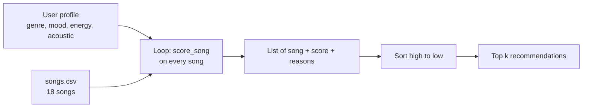

# 🎵 Music Recommender Simulation

## Project Summary

In this project you will build and explain a small music recommender system.

Your goal is to:

- Represent songs and a user "taste profile" as data
- Design a scoring rule that turns that data into recommendations
- Evaluate what your system gets right and wrong
- Reflect on how this mirrors real world AI recommenders

Replace this paragraph with your own summary of what your version does.

---

## How The System Works

### How real recommenders work

Apps like Spotify and TikTok mix two approaches. **Collaborative filtering** looks at other people's behavior ("listeners like you also played this"), using signals like likes, skips, replays, and playlist adds. **Content-based filtering** looks at the songs themselves (genre, tempo, energy, mood) and suggests tracks that sound like what you already enjoy. Real platforms combine both, plus context like time of day, and then run a ranking model over millions of songs.

My simulation is **content-based only**. There are no other users, so it compares one listener's taste profile against each song's attributes. It prioritizes **genre first, then mood, then how close the song's energy is to what the listener wants**, and uses acousticness to separate calm acoustic tracks from produced ones.

### Features used

**`Song`**
- `genre` (e.g. pop, lofi, rock)
- `mood` (e.g. happy, chill, intense)
- `energy` (0.0 to 1.0)
- `acousticness` (0.0 to 1.0)
- Also stored but not scored yet: `title`, `artist`, `tempo_bpm`, `valence`, `danceability`

**`UserProfile`**
- `favorite_genre`
- `favorite_mood`
- `target_energy` (0.0 to 1.0)
- `likes_acoustic` (True / False)

### Dataset

The starter catalog had 10 songs. I added 8 more (ids 11–18) to cover genres and moods that were missing: hip hop, classical, metal, country, edm, r&b, reggae, and folk, with moods like confident, melancholy, angry, nostalgic, euphoric, romantic, uplifting, and sad. The catalog now has **18 songs** across 15 genres.

### Default taste profile

```python
user_prefs = {
    "favorite_genre": "pop",
    "favorite_mood": "happy",
    "target_energy": 0.8,
    "likes_acoustic": False,
}
```

**Critique of this profile:**
- It *can* tell "intense rock" from "chill lofi": energy alone separates them (Storm Runner at 0.91 vs. Library Rain at 0.35), and the acoustic preference pushes the same way.
- It is narrow in one important way: genre is an **exact text match**, so "indie pop" (Rooftop Lights) gets no genre points even though a pop fan would probably like it.
- Because genre is worth twice as much as mood, **Gym Hero** (pop, *intense*) outranks Rooftop Lights (indie pop, *happy*) for this profile: 3.35 vs. 2.29. A "happy pop" listener gets a workout track as their #2 pick.

### Planned scoring rule (for one song)

| Check | Points |
|---|---|
| Genre matches `favorite_genre` | +2.0 |
| Mood matches `favorite_mood` | +1.0 |
| Energy closeness: `1 - abs(song.energy - target_energy)` | 0.0 to +1.0 |
| Acoustic fit: `acousticness` if `likes_acoustic`, else `1 - acousticness`, times 0.5 | 0.0 to +0.5 |

Energy is scored by **closeness**, not "higher is better," so a listener who wants 0.4 energy is not pushed toward the loudest songs. Tempo is left out because in this dataset it rises and falls with energy, so scoring both would count the same thing twice.

### Ranking rule (for the whole list)

Score every song in the catalog, sort from highest to lowest score, and return the top `k`. The scoring rule judges one song at a time; the ranking rule is what turns those scores into a recommendation list.

### Data flow



### Expected bias

Lofi still has 3 songs and pop has 2, while the other 13 genres have only one each, and genre is worth the most points. A metal or jazz fan gets exactly one genre match and then a list filled in by energy alone, while a lofi fan gets three strong matches. The system may also ignore a great song that matches the listener's mood but not their genre, and exact text matching treats "indie pop" as unrelated to "pop."

---

## Getting Started

### Setup

1. Create a virtual environment (optional but recommended):

   ```bash
   python -m venv .venv
   source .venv/bin/activate      # Mac or Linux
   .venv\Scripts\activate         # Windows

2. Install dependencies

```bash
pip install -r requirements.txt
```

3. Run the app:

```bash
python -m src.main
```

### Running Tests

Run the starter tests with:

```bash
pytest
```

You can add more tests in `tests/test_recommender.py`.

---

## Sample Recommendation Output

Output of `python -m src.main` for the default "Happy Pop" profile:

```
Loaded songs: 18

================================================================
Profile: Happy Pop (default)
  genre=pop, mood=happy, energy=0.8, likes_acoustic=False
================================================================
1. Sunrise City by Neon Echo  [pop, happy]
   Score: 4.39
     - genre match: pop (+2.0)
     - mood match: happy (+1.0)
     - energy 0.82 vs target 0.80 (+0.98)
     - produced sound, acousticness 0.18 (+0.41)

2. Gym Hero by Max Pulse  [pop, intense]
   Score: 3.35
     - genre match: pop (+2.0)
     - energy 0.93 vs target 0.80 (+0.87)
     - produced sound, acousticness 0.05 (+0.47)

3. Rooftop Lights by Indigo Parade  [indie pop, happy]
   Score: 2.29
     - mood match: happy (+1.0)
     - energy 0.76 vs target 0.80 (+0.96)
     - produced sound, acousticness 0.35 (+0.33)

4. Concrete Echoes by Blockwise  [hip hop, confident]
   Score: 1.42
     - energy 0.78 vs target 0.80 (+0.98)
     - produced sound, acousticness 0.12 (+0.44)

5. Storm Runner by Voltline  [rock, intense]
   Score: 1.34
     - energy 0.91 vs target 0.80 (+0.89)
     - produced sound, acousticness 0.10 (+0.45)
```

**Screenshot or video** *(optional)*: <!-- Insert a screenshot or demo video link here -->

---

## Experiments You Tried

Use this section to document the experiments you ran. For example:

- What happened when you changed the weight on genre from 2.0 to 0.5
- What happened when you added tempo or valence to the score
- How did your system behave for different types of users

---

## Limitations and Risks

Summarize some limitations of your recommender.

Examples:

- It only works on a tiny catalog
- It does not understand lyrics or language
- It might over favor one genre or mood

You will go deeper on this in your model card.

---

## Reflection

Read and complete `model_card.md`:

[**Model Card**](model_card.md)

Write 1 to 2 paragraphs here about what you learned:

- about how recommenders turn data into predictions
- about where bias or unfairness could show up in systems like this


